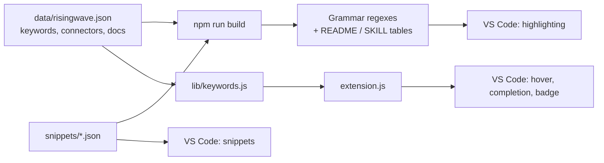

# RisingWave SQL for VS Code

A VS Code extension for writing [RisingWave](https://risingwave.com) streaming SQL pipelines in `.rw` files.

## What it does

[RisingWave](https://docs.risingwave.com) is a PostgreSQL-compatible streaming database. Its SQL adds sources, sinks, continuously updated materialized views, windowing, watermarks and ASOF joins on top of standard PostgreSQL. This extension is an **authoring aid** for that dialect:

- **Highlights** RisingWave-specific syntax in orange, apart from regular PostgreSQL syntax.
- **Explains** keywords and connectors on hover, with syntax, parameters, examples and a docs link.
- **Suggests** connectors, formats, encodings, window and streaming keywords as you type.
- **Scaffolds** sources, sinks, views, windows and joins with 35 snippets.
- **Marks** `.rw` files with an orange `RW` badge and an optional custom icon.

It runs entirely locally. It does **not** connect to a RisingWave instance, run queries, or validate SQL. There is no backend, database or API; see [Architecture](docs/architecture.md).

```sql
-- orders.rw
CREATE SOURCE orders (
  order_id VARCHAR,
  amount   DOUBLE PRECISION,
  ts       TIMESTAMPTZ,
  WATERMARK FOR ts AS ts - INTERVAL '5' SECOND
) WITH (
  connector = 'kafka',                           -- hover: connector docs
  topic = 'orders',
  properties.bootstrap.server = 'broker:9092'
) FORMAT PLAIN ENCODE JSON;                      -- hover: FORMAT / ENCODE

CREATE MATERIALIZED VIEW orders_per_minute AS    -- hover: CREATE MATERIALIZED VIEW
SELECT window_start, COUNT(*) AS n, SUM(amount) AS total
FROM TUMBLE(orders, ts, INTERVAL '1' MINUTE)
GROUP BY window_start
EMIT ON WINDOW CLOSE;
```

## Installation

### From GitHub Releases (recommended)

1. Open the Releases page and pick the latest stable release (`vX.Y.Z`).
2. Under **Assets**, download `risingwave-sql-<version>.vsix`.
3. Install it in VS Code, either:
   - Press `Ctrl+Shift+P` (`Cmd+Shift+P` on macOS) → "Extensions: Install from VSIX..." and select the downloaded file, or
   - Run `code --install-extension risingwave-sql-<version>.vsix`.
4. Reload the window if VS Code prompts you, then open any `.rw` file.

To update, download the newer `.vsix` and install it the same way; it replaces the installed version.

Unreleased changes are published to the rolling **`dev`** pre-release on the same page (`risingwave-sql-<version>-dev.<sha>.vsix`). It's replaced on every push to `dev`, so use it only to try new work.

### From source

```bash
npm ci
npm run package
```

Then install the generated `dist/risingwave-sql-<version>.vsix` as above.

## Features

| Feature | `.rw` Files | `.sql` Files |
|---------|-------------|--------------|
| Syntax Highlighting | ✅ RisingWave + PostgreSQL | ✅ PostgreSQL only |
| Code Snippets | ✅ RisingWave + PostgreSQL | ✅ PostgreSQL only |
| Hover Documentation | ✅ RisingWave keywords | ❌ |
| Code Completion | ✅ Connectors, formats, encodings, window/streaming keywords | ❌ |
| File Icon | ✅ Custom `.rw` icon | Default SQL icon |
| File Badge | ✅ Orange "RW" badge | ❌ |

## Syntax Highlighting

RisingWave-specific keywords are highlighted in **orange** to distinguish them from standard PostgreSQL syntax:

<!-- Generated from data/risingwave.json by `npm run build` — do not edit by hand -->
<!-- GEN:highlight START -->
- **RisingWave DDL**: `CREATE SOURCE`, `CREATE SINK`, `CREATE MATERIALIZED VIEW`, `DROP SOURCE`, `DROP SINK`, `DROP MATERIALIZED VIEW`, `ALTER SOURCE`, `ALTER SINK`, `ALTER MATERIALIZED VIEW`
- **Streaming**: `EMIT ON WINDOW CLOSE`, `EMIT ON UPDATE`, `EMIT IMMEDIATELY`, `WATERMARK FOR`, `WITH WATERMARK`, `ASOF JOIN`, `ASOF LEFT JOIN`, `TEMPORAL JOIN`, `INCLUDE KEY`, `INCLUDE TIMESTAMP`, `INCLUDE PARTITION`, `INCLUDE OFFSET`, `INCLUDE HEADER`
- **Windows**: `TUMBLE`, `HOP`, `SESSION`, `TUMBLE_START`, `TUMBLE_END`, `HOP_START`, `HOP_END`, `SESSION_START`, `SESSION_END`
- **Admin**: `SHOW SOURCES`, `SHOW SINKS`, `SHOW MATERIALIZED VIEWS`, `SHOW JOBS`, `SHOW CLUSTERS`, `SHOW INTERNAL TABLES`, `CANCEL JOB`, `CANCEL JOBS`, `RECOVER`, `FLUSH`, `PAUSE`, `RESUME`, `RISECTL`
- **Connectors**: `kafka`, `postgres-cdc`, `sqlserver-cdc`, `mysql-cdc`, `mongodb-cdc`, `kinesis`, `pulsar`, `s3`, `gcs`, `azblob`, `datagen`, `nexmark`, `mongodb`, `jdbc`, `snowflake`, `clickhouse`, `doris`, `starrocks`, `iceberg`, `delta`, `redis`, `elasticsearch`
- **Formats**: `PLAIN`, `UPSERT`, `DEBEZIUM`, `MAXWELL`, `CANAL`
- **Encodings**: `JSON`, `AVRO`, `PROTOBUF`, `CSV`, `BYTES`
- **Types**: `STRUCT`, `JSONB`, `BYTEA`, `TIMESTAMPTZ`, `TIMESTAMP WITH TIME ZONE`, `RWTIMESTAMP`
<!-- GEN:highlight END -->

PostgreSQL keywords use standard highlighting (blue in most themes).

**Works with any VS Code color theme!** For best results, use the included "RisingWave Theme".

---

## Hover Documentation

Hover over RisingWave keywords to see documentation:

- **Syntax** and usage examples
- **Parameter descriptions** for connectors
- **Links to official documentation**

Supported keywords include:
<!-- GEN:hover START -->
- `CREATE SOURCE`, `CREATE SINK`, `CREATE MATERIALIZED VIEW`, `TUMBLE`, `TUMBLE_START`, `TUMBLE_END`, `HOP`, `HOP_START`, `HOP_END`, `SESSION`, `EMIT ON WINDOW CLOSE`, `WATERMARK`, `ASOF JOIN`, `ASOF LEFT JOIN`, `TEMPORAL JOIN`, `INCLUDE KEY`, `INCLUDE TIMESTAMP`, `proctime`, `FORMAT`, `ENCODE`
- Connector names: `kafka`, `postgres-cdc`, `sqlserver-cdc`, `mongodb`, `snowflake`, `jdbc`
<!-- GEN:hover END -->

---

## Code Snippets

### RisingWave Snippets (`.rw` files)

<!-- GEN:snippets-rw START -->
| Prefix | Description |
|---|---|
| `mv` | Create a RisingWave materialized view (continuously updated) |
| `mvwindow` | Create materialized view with tumbling window aggregation |
| **Sources** |  |
| `sourcekafka` | Create a Kafka source for streaming data ingestion |
| `sourcekafkaupsert` | Create a Kafka source with UPSERT format (requires primary key) |
| `sourcepgcdc` | Create a PostgreSQL CDC source for real-time replication |
| `sourcemssqlcdc` | Create a SQL Server CDC source for real-time replication |
| `sourcemysqlcdc` | Create a MySQL CDC source for real-time replication |
| `sourcedebezium` | Create source from Debezium CDC via Kafka (IBM i, Oracle, etc.) |
| `sourcedatagen` | Create a datagen source for testing (generates mock data) |
| **Sinks** |  |
| `sinkmongo` | Create a MongoDB sink for data delivery |
| `sinkpg` | Create a PostgreSQL sink via JDBC |
| `sinkmssql` | Create a SQL Server sink via JDBC |
| `sinkkafka` | Create a Kafka sink for data delivery |
| `sinksnowflake` | Create a Snowflake sink (via S3 + Snowpipe) |
| **Window Functions** |  |
| `tumble` | Tumbling window aggregation (non-overlapping fixed windows) |
| `hop` | Hopping window aggregation (overlapping sliding windows) |
| `emitclose` | Emit results only when window closes (append-only output) |
| **Joins** |  |
| `asof` | ASOF JOIN for time-series data (matches with nearest timestamp) |
| `temporaljoin` | Temporal join with versioned table |
| **Watermarks** |  |
| `watermark` | Define watermark for event-time processing |
| **Utility** |  |
| `proctime` | Generated column with processing time |
| `computed` | Generated computed column |
| `showsources` | List all sources |
| `showsinks` | List all sinks |
| `showmv` | List all materialized views |
| `desc` | Describe a source, table, or view |
| `explain` | Show query execution plan |
<!-- GEN:snippets-rw END -->

### PostgreSQL Snippets (`.rw` and `.sql` files)

<!-- GEN:snippets-pg START -->
| Prefix | Description |
|---|---|
| `table` | Create a Postgres table |
| `insert` | Insert into a Postgres table |
| `upsert` | Insert with conflict resolution |
| `index` | Create index on a table |
| `fk` | Add a foreign key constraint |
| `func` | Create a Postgres function |
| `win` | Window function example |
| `header` | Insert a standard RisingWave/SQL file header block |
<!-- GEN:snippets-pg END -->

---

## File Icons & Decorations

### Custom Icon
`.rw` files display a custom RisingWave icon in the file explorer.

To enable: Command Palette → "File Icon Theme" → **RisingWave Seti Icons**

### File Badge
All `.rw` files show an orange **"RW"** badge regardless of icon theme.

---

## How it works

Most features are declarative: `package.json` contributes a grammar, snippets, a theme and an icon theme, and VS Code does the rest. Only hover, completion and the `RW` badge run JavaScript (`extension.js`, with the logic in `lib/keywords.js`).



`data/risingwave.json` is the single source of truth. Generated sections of this README (between `<!-- GEN:* -->` markers) and the grammar regexes are overwritten by `npm run build`; never edit them by hand.

### Repository layout

| Path | Purpose |
|---|---|
| `extension.js` | Activation; hover, completion and file-badge providers (the only file using the `vscode` API) |
| `lib/keywords.js` | Pure doc-lookup, compound-keyword and completion logic (unit-testable) |
| `data/risingwave.json` | Keyword groups, functions, types, formats, encodings, connectors, hover docs |
| `scripts/build.js` | Regenerates grammar regexes and README/SKILL sections; `--check` detects drift |
| `syntaxes/`, `snippets/`, `themes/`, `file-icons/`, `icons/` | Contributed assets |
| `test/` | Keyword logic, real TextMate tokenization, drift and manifest checks |
| `docs/` | Detailed documentation (see below) |
| `.github/` | CI, release workflows, and the agent skill `skills/risingwave-sql/SKILL.md` |

## Documentation

| Document | Contents |
|---|---|
| [Architecture](docs/architecture.md) | Layers, runtime providers, grammar structure, build and CI |
| [Data model](docs/db/README.md) | ERDs for `data/risingwave.json` and the snippet files (the repo has no database) |
| [API surface](docs/api.md) | Contribution points and internal module API (there is no HTTP API or OpenAPI spec) |
| [UI & theming](docs/frontend.md) | Colour tokens, scope naming rules, icons, hover layout |
| [User flows](docs/user-flows.md) | Install, first use, authoring, power-user, contributor and release flows |
| [Features](docs/features.md) | Feature checklist with pointers to the implementing modules |
| [Audit](docs/audit.md) | Findings and known limitations |
| [RELEASING.md](RELEASING.md) | How to cut a release |
| [CHANGELOG.md](CHANGELOG.md) | Version history |

---

## Development

1. Clone the repository and run `npm install`
2. Open in VS Code, press `F5` to launch the Extension Development Host
3. Edit `data/risingwave.json` or `snippets/*.json`, then run `npm run build`
4. Run `npm run verify` before committing; add a case to `test/grammar.test.js` for any highlighting change

| Command | Purpose |
|---------|---------|
| `npm run build` | Regenerate grammar regexes and README/SKILL tables from `data/risingwave.json` and `snippets/*.json` |
| `npm run check` | Fail if generated files are out of date |
| `npm run lint` | ESLint |
| `npm test` | Unit tests (hover logic, grammar tokenization, drift, manifest paths) |
| `npm run verify` | `check` + `lint` + `test` (runs automatically on `vscode:prepublish`) |
| `npm run package` | Build the `.vsix` into `dist/` |

Keyword/connector/doc data lives in `data/risingwave.json`. Edit it, then run `npm run build`. Sections of `README.md` and `SKILL.md` between `<!-- GEN:* -->` markers are overwritten by the build.

To cut a release, see [RELEASING.md](RELEASING.md).

---

## Supported Connectors

### Sources (Data Ingestion)
<!-- GEN:connectors-sources START -->
| Connector | Type | Snippet |
|---|---|---|
| Kafka | Streaming | `sourcekafka` |
| Kafka (Upsert) | Streaming | `sourcekafkaupsert` |
| Debezium (Kafka) | CDC | `sourcedebezium` |
| PostgreSQL CDC | CDC | `sourcepgcdc` |
| SQL Server CDC | CDC | `sourcemssqlcdc` |
| MySQL CDC | CDC | `sourcemysqlcdc` |
| MongoDB CDC | CDC | — |
| Kinesis | Streaming | — |
| Pulsar | Streaming | — |
| S3 | Object Storage | — |
| GCS | Object Storage | — |
| Azure Blob | Object Storage | — |
| Datagen | Testing | `sourcedatagen` |
| Nexmark | Testing | — |
<!-- GEN:connectors-sources END -->

### Sinks (Data Delivery)
<!-- GEN:connectors-sinks START -->
| Connector | Type | Snippet |
|---|---|---|
| MongoDB | NoSQL | `sinkmongo` |
| PostgreSQL | RDBMS | `sinkpg` |
| SQL Server | RDBMS | `sinkmssql` |
| Kafka | Streaming | `sinkkafka` |
| Kinesis | Streaming | — |
| Pulsar | Streaming | — |
| Snowflake | Data Warehouse | `sinksnowflake` |
| ClickHouse | Data Warehouse | — |
| Doris | Data Warehouse | — |
| StarRocks | Data Warehouse | — |
| Iceberg | Lakehouse | — |
| Delta Lake | Lakehouse | — |
| S3 | Object Storage | — |
| Redis | Cache | — |
| Elasticsearch | Search | — |
<!-- GEN:connectors-sinks END -->

---

## Documentation

- [RisingWave Docs](https://docs.risingwave.com)
- [RisingWave GitHub](https://github.com/risingwavelabs/risingwave)
- [PostgreSQL 15](https://www.postgresql.org/docs/15/)

---

## Credits

- **RisingWave**: [RisingWave Labs](https://risingwave.com)
- **Icon Theme Base**: [Seti UI](https://github.com/jesseweed/seti-ui)
- **Extension**: USXpress
