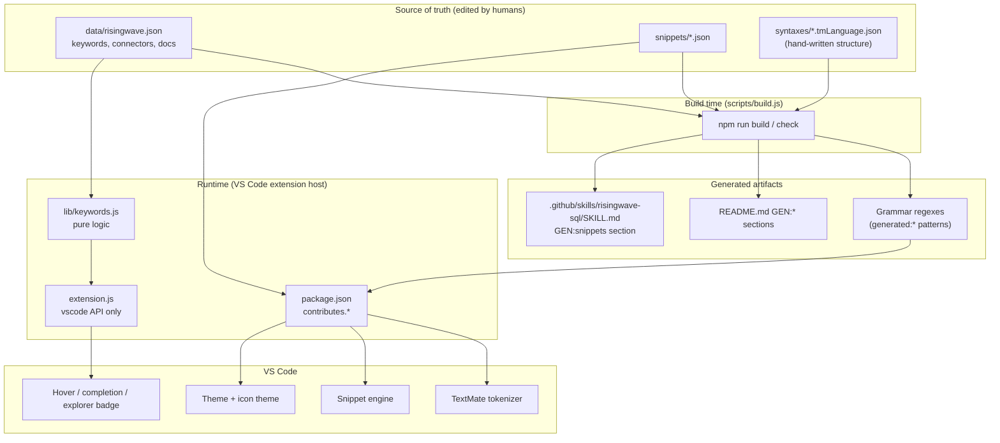
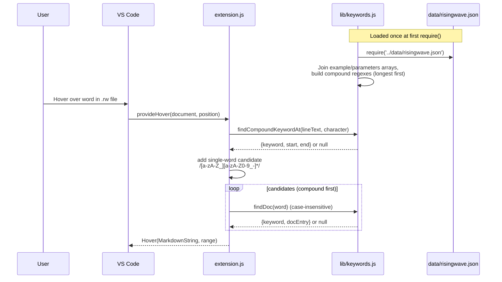
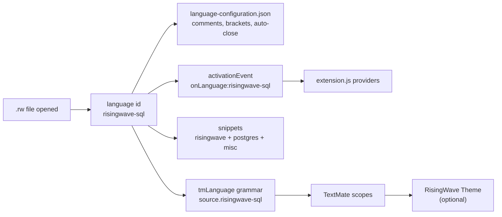
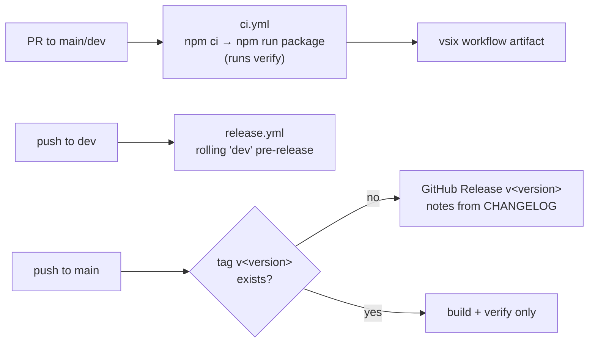

# Architecture

The extension is a **declarative VS Code language extension** with a very small runtime. Most behaviour (highlighting, snippets, icons, theme) is contributed through static JSON in `package.json`; only hover, completion and the file badge run JavaScript.

There is **no server, database, network call or bundler**. Plain CommonJS, loaded by the VS Code extension host.

See also: [data model](db/README.md) · [extension API surface](api.md) · [UI & theming](frontend.md) · [user flows](user-flows.md) · [features](features.md)

## Layers

| Layer | Files | Responsibility |
|---|---|---|
| Data | `data/risingwave.json` | Single source of truth: keyword groups, functions, types, formats, encodings, connectors, hover docs. See [data model](db/README.md). |
| Build | `scripts/build.js` | Regenerates grammar regexes and `<!-- GEN:* -->` doc sections; `--check` fails on drift. |
| Contribution manifest | `package.json` | Declares language, grammar, snippets, themes, icon theme, activation event, default editor settings. |
| Static assets | `syntaxes/`, `snippets/`, `themes/`, `file-icons/`, `icons/`, `language-configuration.json` | Consumed by VS Code directly; no JS involved. |
| Pure logic | `lib/keywords.js` | Doc lookup, compound-keyword matching, completion lists. No `vscode` import, so it is unit-testable. |
| Extension host glue | `extension.js` | The only file that imports `vscode`. Registers three providers. |
| Tests | `test/*.test.js` | `node --test`; see [Testing](#testing). |
| CI/CD | `.github/workflows/` | PR verification and releases. |

## Runtime components

`extension.js` activates on `onLanguage:risingwave-sql` (i.e. when a `.rw` file is opened) and registers three disposables, all pushed to `context.subscriptions`:

| Provider | VS Code API | Scope | Backed by |
|---|---|---|---|
| File badge | `window.registerFileDecorationProvider` | Any URI ending in `.rw` (all workspaces, not just open editors) | Inline in `extension.js` |
| Hover | `languages.registerHoverProvider('risingwave-sql')` | `.rw` only | `findCompoundKeywordAt` + `findDoc` |
| Completion | `languages.registerCompletionItemProvider('risingwave-sql', …, "'", '=')` | `.rw` only | `completionLists` |

### Hover resolution

1. `findCompoundKeywordAt` tries every multi-word keyword (anything containing whitespace, `_` or `.`) sorted **longest first**, so `ASOF LEFT JOIN` wins over `ASOF JOIN`. Whitespace between words is `\s+`, so tabs and multiple spaces work. A match counts only if the cursor is **inside** the span.
2. The single word under the cursor is the fallback candidate (hyphens allowed, so `postgres-cdc` resolves).
3. The first candidate with a doc entry wins. Keywords with no doc of their own (e.g. `WATERMARK FOR`) fall through to the single word (`WATERMARK`).
4. Hover is limited to what is in `data.docs` (26 entries); everything else returns `null`.

### Completion

Completion is **context-free**: every invocation returns the full set of items, regardless of cursor position. Trigger characters are `'` and `=`; VS Code also invokes it on normal typing. Lists come from `completionLists`:

| Kind | Source | `CompletionItemKind` | Detail label |
|---|---|---|---|
| Connectors | `connectors.sources` + `connectors.sinks` (deduplicated names) | `Constant` | RisingWave Connector |
| Formats | `formats` | `Keyword` | Data Format |
| Encodings | `encodings` | `Keyword` | Data Encoding |
| Keywords | `keywords.window` + `keywords.streaming` + `functions` | `Keyword` | RisingWave Keyword |

DDL, admin, option and `FORMAT`/`ENCODE` keywords are **not** offered. Documentation text is attached when `docs` has an entry of the same name.

## Static contribution pipeline

- `.sql` files get only `snippets/postgres.json` and `snippets/misc.json` (contributed under language `sql`). They get no grammar, hover or completion from this extension.
- `configurationDefaults` for `[risingwave-sql]` set `editor.wordBasedSuggestions: matchingDocuments` and `editor.suggest.insertMode: replace`.

### Grammar structure

`syntaxes/risingwave.tmLanguage.json` is the only hand-edited file that is also partially generated. Pattern order in the top-level `patterns` array matters (first match at a position wins):

`comments` → `risingwave-option-blocks` → `strings` → `numbers` → `risingwave-keywords` → `risingwave-functions` → `risingwave-types` → `postgresql-keywords` → `postgresql-functions` → `operators` → `identifiers`

- `risingwave-option-blocks` handles `WITH ( … )` and `ENCODE <enc> ( … )`. Inside, `risingwave-option-body` colours `connector = '<name>'`, well-known option keys, and any other `dotted.key =` as a parameter. This is why `type`, `connector`, etc. are highlighted **only** inside option blocks.
- Patterns carrying `"comment": "generated:<id> …"` have their `match`/`begin` regex overwritten by `build.js`. Everything else (PostgreSQL keywords, operators, strings) is hand-written.
- `JSON` is a RisingWave format value only after `ENCODE`; otherwise it falls through to the PostgreSQL type.

Generated IDs: `ddl`, `streaming`, `window`, `admin`, `functions`, `types`, `format-keywords`, `format`, `encode`, `encode-options`, `option`, `connector-value` (all in `grammarRegexes` in `scripts/build.js`). A `generated:*` pattern without a generator, or a generator without a pattern, throws.

## Build system

`scripts/build.js` is a pure text transform with three outputs:

| Output | Mechanism |
|---|---|
| `syntaxes/risingwave.tmLanguage.json` | Regex-replaces the `match`/`begin` line of each `generated:<id>` pattern; validates the result with `JSON.parse`. |
| `README.md` | Replaces content between `<!-- GEN:<name> START -->` and `END` markers: `highlight`, `hover`, `snippets-rw`, `snippets-pg`, `connectors-sources`, `connectors-sinks`. |
| `.github/skills/risingwave-sql/SKILL.md` | Same, for the `snippets` marker. |

`--check` computes the outputs and exits 1 if any file would change. Build also fails if a connector's `snippet` prefix does not exist in `snippets/risingwave.json`, or a marker pair is missing.

## Testing

| File | Covers |
|---|---|
| `test/keywords.test.js` | Compound-keyword span matching, longest-first ordering, `findDoc`, doc-entry shape, data cross-references, completion list uniqueness. |
| `test/grammar.test.js` | Tokenizes real SQL with `vscode-textmate` + `vscode-oniguruma` (WASM) and asserts scopes. |
| `test/build.test.js` | Runs `build.js --check`; verifies every path in `package.json` contributions exists. |

`extension.js` itself is **not** unit-tested (it needs the `vscode` module); correctness there relies on keeping logic in `lib/keywords.js` and on a manual F5 check.

## CI/CD

`npm run verify` = `check` + `lint` + `test`; it also runs on `vscode:prepublish`, so `npm run package` cannot produce a vsix from a broken tree. Full release steps are in [RELEASING.md](../RELEASING.md).

## Design constraints

- Keep `vscode` imports in `extension.js` only; put logic in `lib/`.
- Edit data, not generated output: change `data/risingwave.json` or `snippets/*.json`, then `npm run build`.
- Add a grammar test for every highlighting change.
- Docs live in `docs/`; architecture summary for agents lives in `.cursor/rules/architecture.mdc`.
