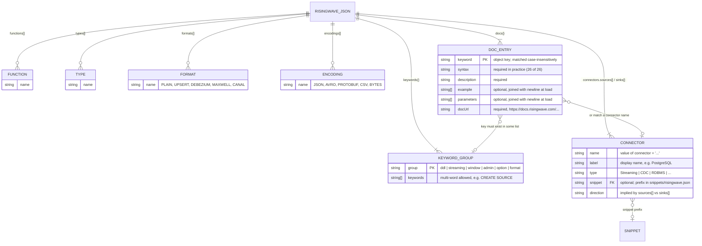
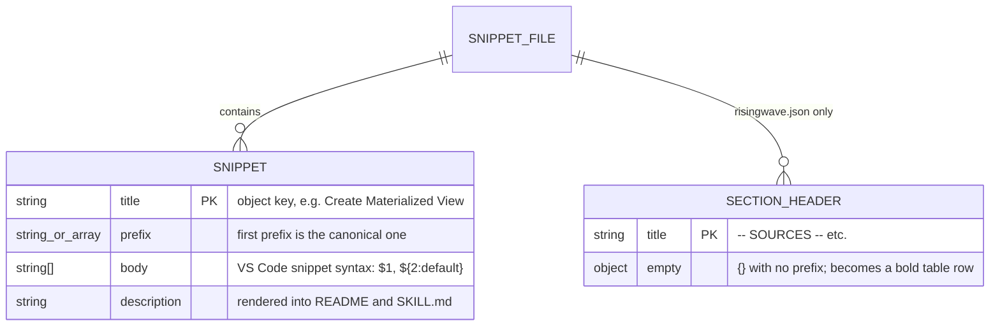
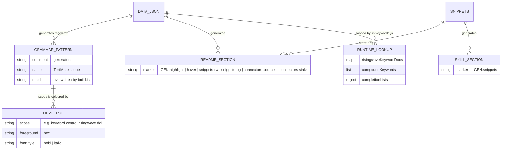

# Data model

**This repo has no database.** Nothing is stored, queried or migrated at runtime, and the extension makes no network calls. There is no SQL schema to diagram.

The closest equivalent is the set of JSON files that act as the extension's data store. They have real structure, real relationships and tests that enforce them, so this page documents those as entity-relationship diagrams.

> The SQL in `snippets/` and `.github/skills/risingwave-sql/SKILL.md` is **example RisingWave SQL for users to write in their own projects**. It is not this project's schema.

See also: [architecture](../architecture.md) · [features](../features.md)

## Where the data lives

| Store | Path | Role | Edited by |
|---|---|---|---|
| Keyword data | `data/risingwave.json` | Single source of truth for highlighting, hover and completion | Hand |
| Snippets (RisingWave) | `snippets/risingwave.json` | 27 prefixed snippets plus 6 section-header entries | Hand |
| Snippets (PostgreSQL) | `snippets/postgres.json` | 7 snippets, also contributed to `sql` files | Hand |
| Snippets (misc) | `snippets/misc.json` | 1 snippet (`header`), also contributed to `sql` files | Hand |
| Grammar | `syntaxes/risingwave.tmLanguage.json` | TextMate rules; `generated:*` regexes are overwritten | Hand + `build.js` |
| Theme | `themes/risingwave-color-theme.json` | Scope → colour map | Hand |

## ERD 1: `data/risingwave.json`

### Fields and constraints

| Entity | Notes |
|---|---|
| `keywords.<group>` | Six groups: `ddl` (9), `streaming` (13), `window` (9), `admin` (13), `option` (6), `format` (2). Each group maps to one grammar scope (`keyword.control.risingwave.<group>`). |
| `functions` | Currently only `proctime`. Other functions (`LAG`, `NOW`, …) are PostgreSQL and live in the grammar by hand. |
| `types` | RisingWave-specific types only (`STRUCT`, `JSONB`, `RWTIMESTAMP`, …). |
| `connectors.sources` / `sinks` | 14 sources, 15 sinks. **`name` is not unique**: `kafka` appears as a source and a sink; `jdbc` is used by both the PostgreSQL and SQL Server sinks. `label` + direction identifies an entry. `snippet` is optional. |
| `docs` | 26 entries. The key is the displayed keyword (case-preserved: `proctime`, `kafka`). Lookup is case-insensitive. |
| `$comment` | Free-text note, ignored by code. |

### Invariants enforced by tests

| Invariant | Test |
|---|---|
| Every `docs` key exists in some keyword list, function, type, format, encoding or connector name (plus `WATERMARK`, the single-word form of `WATERMARK FOR`) | `test/keywords.test.js` |
| Every `docs` entry has `description` and an `https://docs.risingwave.com/` `docUrl`; `example` / `parameters` are strings after load | `test/keywords.test.js` |
| Every connector `snippet` references an existing snippet prefix | `test/keywords.test.js` and `scripts/build.js` |
| Completion lists are non-empty and have no duplicates | `test/keywords.test.js` |
| Compound keywords are sorted longest-first | `test/keywords.test.js` |

Not enforced: that `syntax` is present, that connector `type` values come from a closed set (currently ten distinct values), or that `docUrl` links are live.

## ERD 2: snippet files

- Section headers exist only so `build.js` can group the README table; VS Code ignores entries without a `prefix`.
- Aliases: 24 of the 27 prefixed snippets in `risingwave.json` carry multiple prefixes (e.g. `sourcekafka` and `kafkasource`). Only the first appears in docs. `postgres.json` and `misc.json` use single string prefixes.
- `risingwave.json` is contributed to `risingwave-sql` only. `postgres.json` and `misc.json` are contributed to both `risingwave-sql` and `sql`.

## ERD 3: how the stores feed each other

Rules for editing: change the left-hand store, run `npm run build`, commit both. `npm run check` (and the test suite) fails if generated output is stale.

## Adding a new connector (data change walkthrough)

1. Add `{ name, label, type, snippet? }` to `connectors.sources` or `connectors.sinks` in `data/risingwave.json`.
2. Optionally add a snippet to `snippets/risingwave.json` and reference its first prefix in `snippet`.
3. Optionally add a `docs` entry keyed by the connector `name`.
4. `npm run build`, then `npm run verify`.

Result: the name is highlighted inside `connector = '…'`, offered by completion, listed in the README tables, and (if documented) shown on hover.
