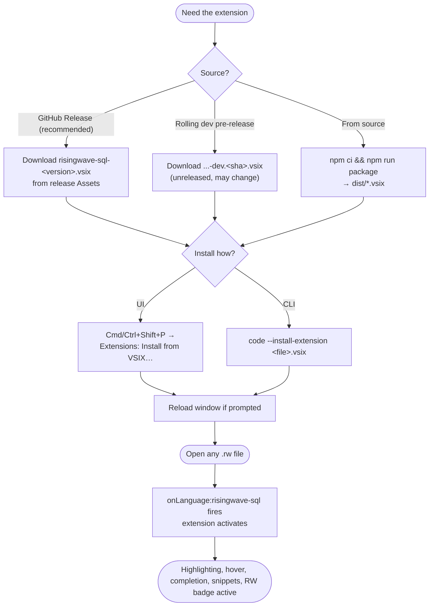
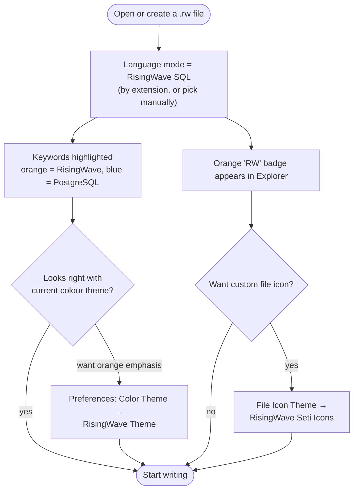
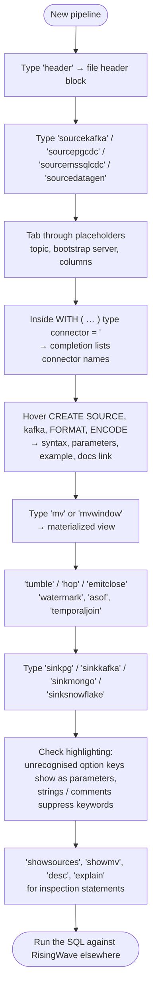
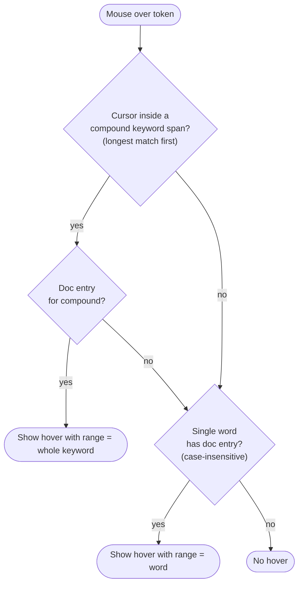
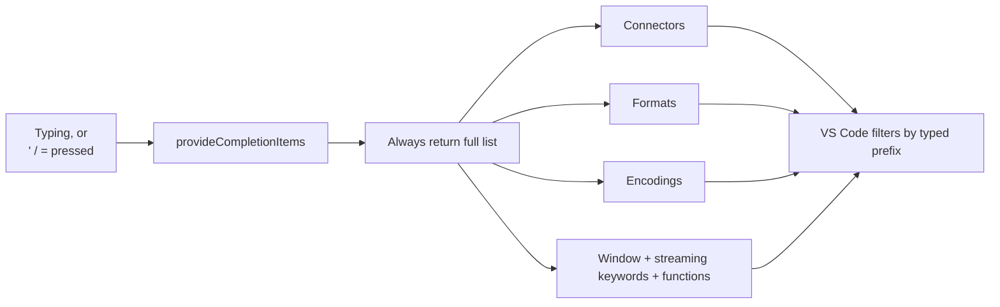
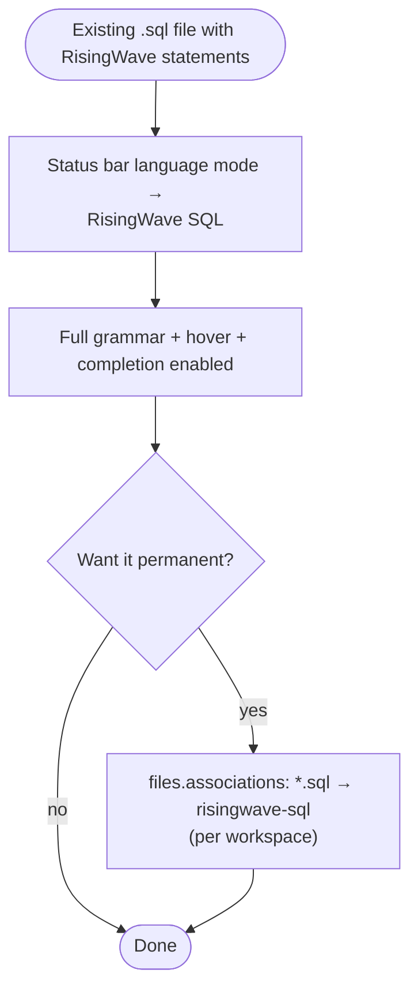
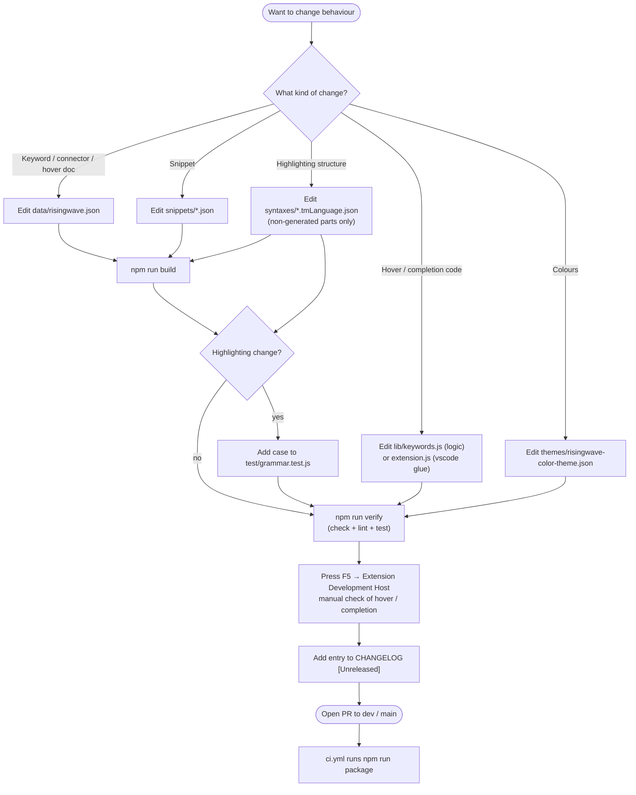
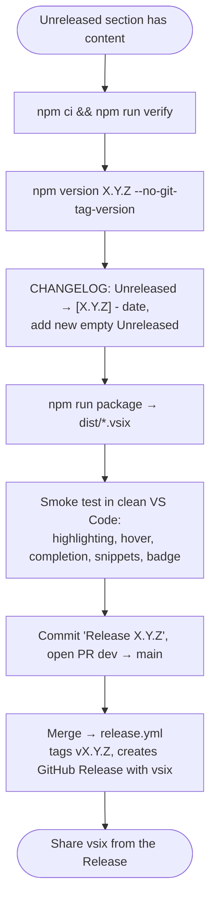

# User flows

This is a local editor extension, so there is **no signup, login, account or backend session**. The flows below are the real journeys: install → first use → everyday authoring → power use, plus the contributor and release paths.

See also: [features](features.md) · [architecture](architecture.md) · [UI & theming](frontend.md)

## Personas

| Persona | Goal | Entry point |
|---|---|---|
| Pipeline author | Write RisingWave streaming SQL in `.rw` files quickly and correctly | Install `.vsix`, open a `.rw` file |
| Power user | Move fast with snippets, compound-keyword hovers, themed output; also edit `.sql` | Command palette, snippets, theme and icon theme |
| Contributor | Add keywords, connectors, snippets or grammar rules | Clone repo, edit data, `npm run build` |
| Releaser | Ship a new `.vsix` | `RELEASING.md` |

## 1. Install ("signup" equivalent)

Updating is the same flow: installing a newer `.vsix` replaces the old one. There is no auto-update because the extension is not published to a marketplace.

## 2. First-time use (first `.rw` file)

Opting in to the theme and icon theme is optional and independent.

## 3. Everyday authoring: build a pipeline

The extension **does not connect to RisingWave, run, lint or validate SQL**. It is purely an authoring aid; execution happens in `psql`, a DB client or CI.

### Hover decision flow

Examples: hovering `my_src` in `CREATE SOURCE my_src` shows nothing; `WATERMARK FOR` shows the `WATERMARK` doc; `postgres-cdc` shows the connector doc; `ASOF LEFT JOIN` resolves to its own doc (the longest compound wins; there is no fallback to the shorter `ASOF JOIN`, so every compound keyword needs its own entry to show a hover).

### Completion decision flow

Filtering is done by VS Code on the typed prefix; the extension does not look at context (e.g. it will offer `kafka` outside a `WITH` block).

## 4. Power-user paths

| Path | How | Why it helps |
|---|---|---|
| Snippet aliases | Many snippets have two prefixes (`sourcekafka` / `kafkasource`, `mv` / `createmv`) | Use whichever you remember |
| Postgres snippets in `.sql` | `table`, `insert`, `upsert`, `index`, `fk`, `func`, `win`, `header` also work in plain `.sql` files | Same muscle memory outside `.rw` |
| Scope inspection | **Developer: Inspect Editor Tokens and Scopes** | Debug why something is coloured as it is; target scopes in `editor.tokenColorCustomizations` |
| Custom token colours | Override `keyword.control.risingwave.*` etc. in user settings with any theme | Keep your theme, change RisingWave accents. See [frontend](frontend.md) |
| Explicit language mode | Set a non-`.rw` file (e.g. `.sql`) to **RisingWave SQL** via the status bar | Get hover and completion on files that are not named `.rw` |
| Agent skill | `.github/skills/risingwave-sql/SKILL.md` | Gives Copilot/Cursor/Claude Code RisingWave-vs-PostgreSQL syntax guidance in this repo |

## 5. Contributor flow

Hard rules: never hand-edit between `GEN:*` markers or generated grammar `match`/`begin` lines; do not commit `.vsix` files.

## 6. Release flow

Details and the checklist: [RELEASING.md](../RELEASING.md).

## 7. Troubleshooting paths

| Symptom | Likely cause | Fix |
|---|---|---|
| No hover / completion | File is not in `risingwave-sql` mode (e.g. `.sql`) | Set language mode to **RisingWave SQL** |
| No orange keywords | Theme overrides colours, or `.sql` file (PostgreSQL scopes only) | Use **RisingWave Theme** or set `editor.tokenColorCustomizations` |
| Custom `.rw` icon missing | Icon theme not selected | **File Icon Theme → RisingWave Seti Icons** |
| `RW` badge missing | File does not end in `.rw` | Rename; badge keys off the file extension only |
| `type`/`connector` not coloured | Used outside `WITH ( … )` / `ENCODE x ( … )` | By design; option keys only highlight inside option blocks |
| `JSON` coloured as a PostgreSQL type | Not preceded by `ENCODE` | By design |
| Hover missing on a keyword split across lines | Compound keywords match within one line | Known limitation, see [audit](audit.md#known-limitations) |
| `npm run check` fails | Edited data/snippets without rebuilding | `npm run build`, commit result |
